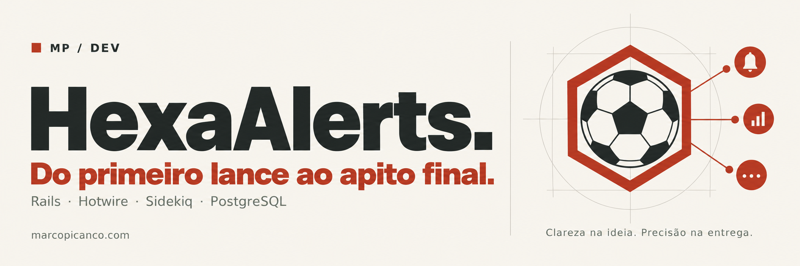
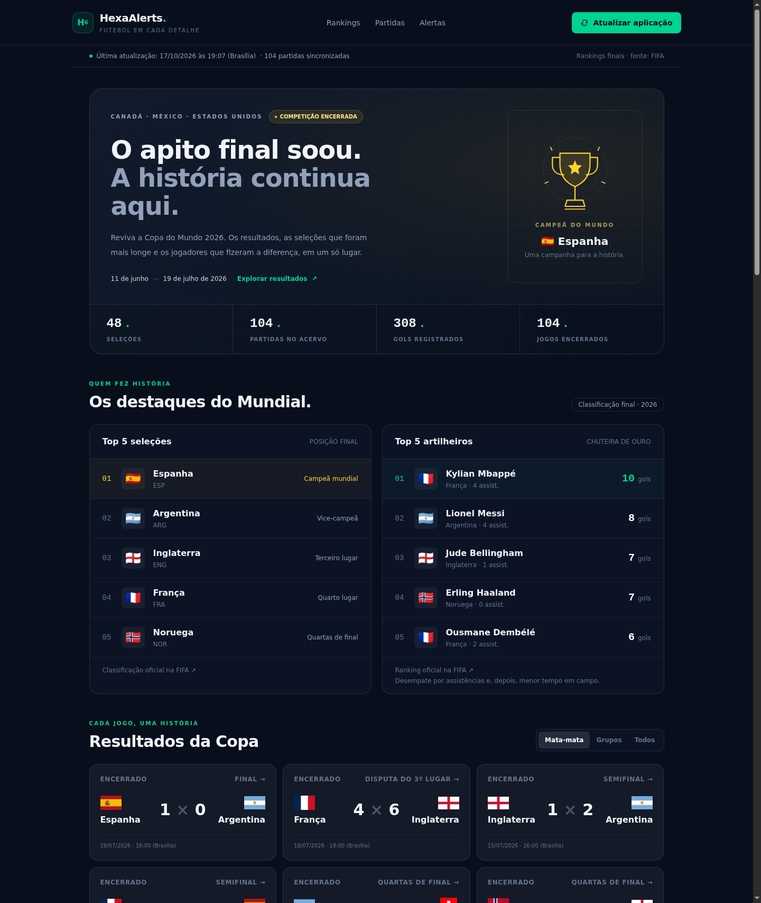
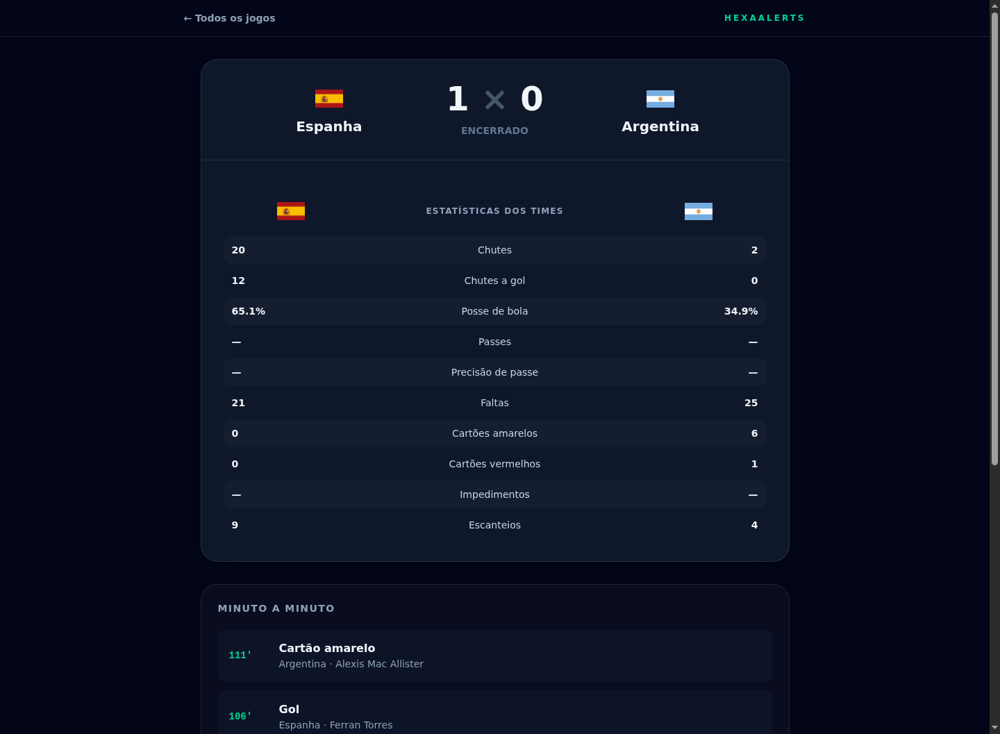
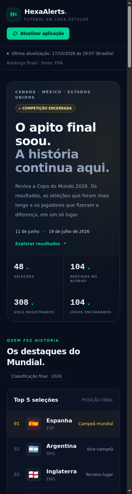
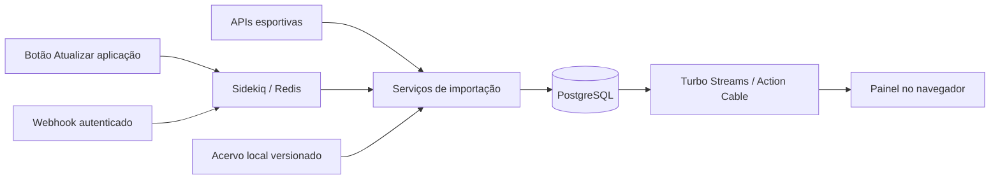

<p align="center">
  
</p>

# HexaAlerts ⚽

**Do primeiro lance ao apito final: uma aplicação Rails para acompanhar a Copa do Mundo de 2026.**

Projeto de portfólio que combina integração com APIs esportivas, processamento em
segundo plano e atualizações no navegador com Hotwire. Com a competição encerrada,
o painel funciona como um acervo navegável: resultados das 104 partidas, as cinco
melhores seleções e os cinco principais artilheiros.



<p align="center">
  <strong>Ruby on Rails 8.1</strong> · PostgreSQL · Redis · Sidekiq · Hotwire · Bun · Tailwind CSS
</p>

[Funcionalidades](#funcionalidades) · [Executar localmente](#executar-localmente) ·
[Arquitetura](#arquitetura) · [Principais desafios enfrentados](#principais-desafios-enfrentados) ·
[Testes](#testes-e-qualidade)

## Funcionalidades

- **Retrospectiva do torneio:** estado de competição encerrada, campeã em destaque
  e indicadores calculados a partir das partidas cadastradas.
- **Rankings finais:** top 5 seleções e top 5 artilheiros, com gols, assistências e
  links para as publicações oficiais da FIFA.
- **Atualizar aplicação:** um botão sincroniza seleções, calendário, placares,
  estatísticas e lances de todo o torneio em segundo plano. O painel informa o
  andamento e a última atualização, e se recarrega ao concluir via Turbo Streams.
- **Acervo de partidas:** filtros por grupos, mata-mata ou todos os jogos,
  incluindo final e disputa do terceiro lugar.
- **Detalhes de cada jogo:** placar, posse de bola, chutes, faltas, cartões,
  escanteios e lances registrados por jogador.
- **Alertas personalizados:** assinaturas por torcedor, seleção, partida e tipo
  de evento, com distribuição apenas aos assinantes interessados.
- **Webhooks autenticados:** validação do contrato, comparação de token em tempo
  constante e processamento idempotente com Sidekiq.
- **Demonstração reproduzível:** seeds com as 48 seleções e as 104 partidas, sem
  depender da disponibilidade das APIs nem de uma chave paga.
- **Interface responsiva:** navegação em desktop e celular, foco de teclado
  visível e respeito à preferência por movimento reduzido.

## A aplicação em funcionamento

As imagens deste repositório são capturas reais da aplicação executando localmente,
com os dados históricos carregados pelo seed.

### Partida: placar, estatísticas e lances



### Experiência no celular

<p align="center">
  
</p>

Para gerar novamente as imagens, inicie a aplicação, carregue os seeds e execute:

```bash
SCREENSHOT_BASE_URL=http://localhost:3000 bin/screenshots
```

O script usa Chrome em modo headless via Selenium, salva as três imagens em
`docs/screenshots` e verifica se há transbordamento horizontal no celular.

## Executar localmente

### Pré-requisitos

- Ruby compatível com [`.ruby-version`](.ruby-version) e Bundler.
- PostgreSQL em execução, com permissão para criar os bancos locais.
- Redis em execução.
- Bun para instalar as dependências e compilar JavaScript e CSS.
- Google Chrome para gerar as capturas de tela; não é necessário para subir o servidor.

### Preparar e iniciar

```bash
# Instala dependências, compila assets e prepara o banco
bin/setup --skip-server

# Carrega as 48 seleções, 104 partidas e os lances do acervo local
bin/rails db:seed

# Em outro terminal, caso o Redis ainda não esteja em execução
redis-server

# Inicia Rails, JavaScript, CSS e Sidekiq
bin/dev
```

Acesse **http://localhost:3000**. Para usar outra porta:

```bash
PORT=3003 bin/dev
```

O botão **Atualizar aplicação** usa o worker Sidekiq iniciado pelo `bin/dev`.
Durante a sincronização, o botão fica indisponível e o banco impede que duas
atualizações sejam iniciadas ao mesmo tempo. Ao concluir, o painel é atualizado
sem exigir que o usuário recarregue a página.

Também é possível sincronizar diretamente pelo terminal, sem worker:

```bash
bin/rails competition:refresh
```

Os seeds usam somente arquivos versionados. Reexecutá-los reaproveita as seleções,
partidas e eventos existentes, sem apagar assinaturas de torcedores.

### Assets

Os arquivos compilados de `app/assets/builds` não são versionados. O `bin/setup`
e o `bin/dev` preparam o frontend. Se optar por iniciar apenas `bin/rails server`,
gere os assets antes:

```bash
bun install
bun run build
bun run build:css
bin/rails server
```

Isso evita o erro `The asset 'application.js' was not found in the load path`.

## Arquitetura



| Camada | Responsabilidade |
| --- | --- |
| Controllers | Receber requisições, validar entradas e iniciar operações. |
| Models | Associações, validações e integridade do domínio. |
| Services | Clientes HTTP, normalização, importação e reconciliação entre provedores. |
| Jobs | Processar eventos e executar sincronizações fora da requisição web. |
| PostgreSQL | Fonte de verdade, índices únicos e histórico de sincronizações. |
| Redis | Filas do Sidekiq e distribuição das mensagens do Action Cable. |
| Hotwire | Turbo Streams para atualizações e Stimulus para interações locais. |

A sincronização completa registra seu estado em `CompetitionSync`: na fila,
em execução, concluída ou falhou. Os detalhes indicam quantas partidas foram
importadas e se os dados vieram da API ou da cópia local. Uma falha mantém os
dados persistidos disponíveis e libera uma nova tentativa pelo botão.

## Dados e integrações

### Acervo e rankings finais

O arquivo [`summary.json`](db/data/worldcup2026/summary.json) registra os rankings
finais conferidos em **17/10/2026**, com os links de origem:

- [FIFA — classificação final do torneio](https://www.fifa.com/en/articles/final-tournament-standings).
- [FIFA — artilharia e Chuteira de Ouro](https://www.fifa.com/en/tournaments/mens/worldcup/canadamexicousa2026/articles/adidas-golden-boot-race-top-scorer).

Os rankings são um registro histórico versionado. Não são inferidos de um
conjunto parcial de eventos e não são recalculados pelo botão de atualização.
A ordem da artilharia segue a publicação da FIFA, incluindo os desempates por
assistências e menor tempo em campo.

O acervo [`espn_matches.json`](db/data/worldcup2026/espn_matches.json) contém as
104 partidas, com data da captura e endereço da consulta de origem. O encerramento
da competição considera o calendário da edição, cuja final ocorreu em 19/07/2026.

### Provedores

| Fonte | Dados | Configuração |
| --- | --- | --- |
| World Cup 2026 API | Seleções e calendário inicial | `WORLD_CUP_API_URL`, opcional. |
| ESPN Scoreboard | Resultados, fases, estatísticas e lances | `ESPN_SCOREBOARD_URL`, opcional. |
| football-data.org v4 | Fonte complementar de calendário e placares | `FOOTBALL_DATA_API_TOKEN`, opcional. |
| Arquivos locais | Demonstração e alternativa quando as APIs falham | Versionados em `db/data/worldcup2026`. |

A atualização completa consulta a temporada inteira na ESPN com limite de 200
registros, suficiente para as 104 partidas. Se a ESPN estiver indisponível, o
sistema usa o acervo local e sinaliza essa origem no painel. A fonte secundária
é consultada quando sua chave está configurada; sua indisponibilidade não impede
a sincronização principal.

Comandos individuais continuam disponíveis:

```bash
bin/rails world_cup:sync
bin/rails espn:sync

# Opcional, com uma chave que tenha acesso à competição WC de 2026
FOOTBALL_DATA_API_TOKEN=sua-chave bin/rails football_data:sync
```

Durante o torneio, a sincronização recorrente da ESPN usa intervalos de 30
segundos com jogos ao vivo e cinco minutos sem jogos ao vivo. Depois do fim da
competição, o ciclo recorrente não é iniciado novamente; o acervo pode continuar
sendo atualizado manualmente.

### Webhook de eventos

```http
POST /api/v1/webhooks/match_events
Content-Type: application/json
X-Webhook-Token: dev-token
```

Exemplo para testar o fluxo de recebimento e processamento em segundo plano.
Use o identificador de uma partida cadastrada, disponível no console com
`Match.first.external_id`:

```bash
curl -X POST http://localhost:3000/api/v1/webhooks/match_events \
  -H "Content-Type: application/json" \
  -H "X-Webhook-Token: dev-token" \
  -d '{
    "event_id": "demo-event-001",
    "match_id": "worldcup2026:1",
    "type": "goal",
    "team_code": "MEX",
    "occurred_at": "2026-06-11T19:22:10Z",
    "player": "Jogador de demonstração"
  }'
```

A simulação altera o placar local; rode a atualização completa para restaurar os
resultados históricos depois da demonstração. O endpoint responde `202` para um
payload válido, `401` para token inválido e `422` para dados fora do contrato.
Em desenvolvimento e teste, o token alternativo é `dev-token`. Em produção,
configure `WEBHOOK_TOKEN`.

## Principais desafios enfrentados

1. **Receber eventos repetidos sem duplicar gols ou notificações.**
   Provedores podem reenviar o mesmo webhook. O identificador externo tem índice
   único, o job usa proteção contra concorrência e os testes verificam que o
   mesmo evento altera o placar uma única vez.

2. **Reconciliar a mesma partida em provedores diferentes.**
   Cada API usa identificadores próprios e pode informar horários diferentes.
   A importação combina equipes e uma janela de horário, mantém referências
   externas alternativas e reúne eventos e assinaturas na partida canônica.

3. **Manter a aplicação demonstrável quando uma API sai do ar.**
   Os clientes HTTP têm limites de tempo, tratam respostas inválidas e usam
   arquivos locais como alternativa. O seed carrega o torneio completo sem
   chamadas externas, e o painel identifica quando uma atualização usou a cópia local.

4. **Atualizar todo o torneio sem bloquear a navegação.**
   O botão enfileira um job no Sidekiq. O estado da operação fica no PostgreSQL,
   um índice único parcial impede atualizações simultâneas e o Turbo Streams
   atualiza o navegador ao término. Falhas ficam visíveis e permitem tentar novamente.

5. **Transformar um painel ao vivo em um acervo coerente após a final.**
   O painel passou a mostrar o encerramento, a campeã, os rankings finais e as
   fases eliminatórias. A sincronização consulta toda a temporada, importa
   partidas ausentes e interrompe o ciclo recorrente após o torneio. Probabilidades
   ao vivo não são exibidas em partidas encerradas.

6. **Evitar a regressão de dados ao usar um calendário alternativo.**
   A importação de arquivos locais preserva placares e estados já atualizados,
   mantém os dados detalhados de outros provedores e reaproveita os registros.
   Testes de importação cobrem idempotência e preservação dos resultados.

7. **Garantir que o frontend funcione em uma instalação nova.**
   JavaScript e CSS compilados não ficam no Git. O `bin/setup` gera os bundles
   exigidos pelo Propshaft, e o `bin/dev` acompanha as alterações com Bun e
   Tailwind. O processo de instalação e a geração das capturas estão documentados.

## Testes e qualidade

```bash
bin/rails test
bin/rails db:test:prepare test:system
bin/rubocop
bundle exec brakeman --no-pager
```

A suíte cobre o contrato e a autenticação do webhook, processamento idempotente,
assinaturas, estatísticas, reconciliação de partidas, fallback do acervo completo,
rankings, filtros, exclusão de atualizações simultâneas e estados de sucesso e
falha da sincronização. APIs são substituídas por clientes de teste para que a
suíte não dependa de rede ou credenciais.

Os testes de sistema usam Chrome em modo headless e cobrem rankings, navegação
entre fases e detalhes das partidas, criação e remoção de alertas, layout no
celular e atualização automática do painel após a execução do job. Os serviços
externos são substituídos durante o teste da sincronização; Redis e Sidekiq não
precisam estar em execução para rodar a suíte.

## Próximos passos

- Autenticação de torcedores e autorização para operações administrativas.
- Preferências por canal de entrega, como e-mail e push.
- Métricas de latência e painel de observabilidade das integrações.
- Adaptar o domínio para outras competições e edições.
